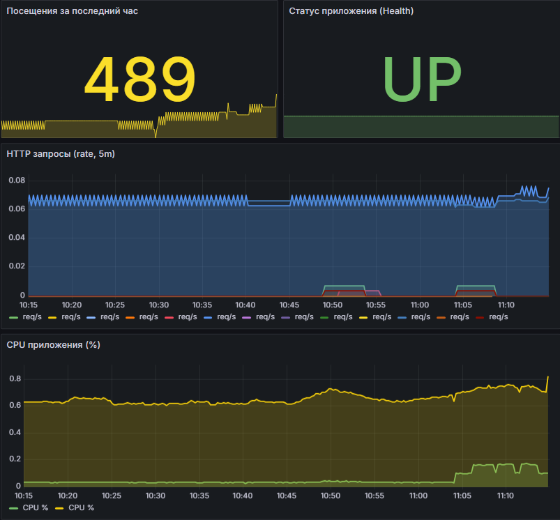
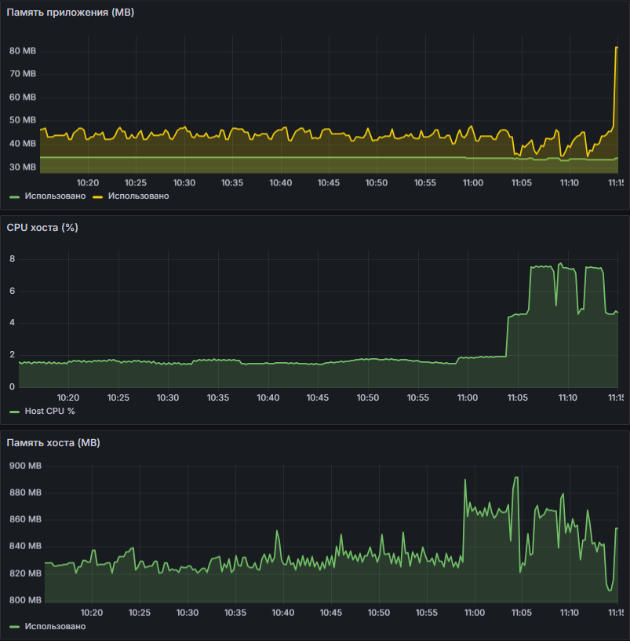

# Arabic Learning Tracker

Полный цикл CI/CD и мониторинга для приложения сохранения арабских слов.

## Ссылки

| Сервис | URL | Описание |
| :--- | :--- | :--- |
| **Приложение** | [http://195.19.213.5:8080](http://195.19.213.5:8080) | Веб-интерфейс и REST API |
| **Health Check** | [http://195.19.213.5:8080/health](http://195.19.213.5:8080/health) | Статус работоспособности (JSON) |
| **Метрики (Prometheus)**| [http://195.19.213.5:8080/metrics](http://195.19.213.5:8080/metrics) | Экспорт метрик приложения |
| **Grafana** | [http://195.19.213.5:3000](http://195.19.213.5:3000) | Дашборды (логин/пароль: `admin`/`admin`) |
| **cAdvisor** | [http://195.19.213.5:8081](http://195.19.213.5:8081) | Метрики ресурсов контейнеров и хоста |
---

## Описание CI/CD процесса

Пайплайн настроен таким образом, чтобы гарантировать воспроизводимость и чистоту сборки:

1. **Сборка артефакта (`ci/build.sh`)**: 
   - Запускается в изолированном Docker-контейнере
   - Устанавливаются зависимости, запускаются тесты
   - Создаётся Python-артефакт (`.whl` файл), который сохраняется в папку `artifacts/`
2. **Упаковка в образ**: 
   - `Dockerfile` настроен на сборку из артефакта
3. **Деплой (`deploy/deploy.sh`)**:
   - Артефакт передаётся на сервер
   - Собирается финальный Docker-образ
   - Стек поднимается через `docker compose up -d`
---

## Как запустить проект

```bash
# Клонировать репозиторий
git clone https://github.com/BareltInc/buz-lab-devops.git
cd buz-lab-devops

# Запустить сборку
bash ci/build.sh

# Развернуть приложение
bash deploy/deploy.sh
```
---

## Мониторинг

Настроен автоматический provisioning Grafana и Prometheus.

### Скриншоты мониторинга




> **⚠️ Примечание по метрикам контейнеров**: 
> Метрики потребления ресурсов на уровне отдельных Docker-контейнеров (cAdvisor) могут агрегироваться или не отображаться детально из-за ограничений доступа к `cgroups` на уровне ядра предоставленного VPS-хостинга. Для гарантии стабильности используются метрики самого процесса приложения (`process_*`), которые работают корректно на любой инфраструктуре.
